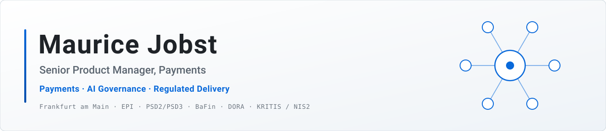

<p align="center">
  <picture>
    <source media="(prefers-color-scheme: dark)" srcset="assets/header-dark.svg">
    <source media="(prefers-color-scheme: light)" srcset="assets/header-light.svg">
    
  </picture>
</p>

I'm a Senior Product Manager in Frankfurt am Main, and I work on payment products for public transport 
💳 You tap your bank card at the gate, and I look after what happens between that tap and the money settling: EMV acceptance at the validator, the account-based back office, and the banks and PSPs in between.

**Senior Product Manager, Cubic Transportation Systems** (2026–present, at Cubic since 2021) · 📍 Rhein-Main · 🗣️ German and English

Today that's Umo Pass, open-loop payments for transit in the US, Canada and Oceania. Umo is not in EMEA yet, so I also do the compliance groundwork for its first European bids, where EU digital identity at the gate meets account-based ticketing and EPI. I've spent 15+ years in payments and regulated work, starting at PayPal in Dublin.

## Some of the work I got to be part of

- 📱 **A transit app with 3M+ users went from 1.6 to 4.0 stars** through the Deutschland-Ticket launch, with zero downtime. The client renewed at €2M+ a year. I was the Senior Technical Project Manager on that €5M+ B2G program and led 20+ people across vendors and partner organizations, with nobody reporting to me. [How the delivery was run →](case-studies/deutschland-ticket-turnaround.md)
- 💳 **Open-loop payments from the tap to settlement**, which is my job today. [Case study →](case-studies/open-loop-payments-end-to-end.md)
- 🏦 **A banking act turned into engineering specs.** At Velvon Bank I turned KWG requirements into specs for core banking on GCP, for a banking-license acquisition under BaFin scrutiny. The parent stopped the German launch in early 2020, before the bank opened. [Case study →](case-studies/banking-act-to-specifications.md)
- 🤖 **An AI usage standard that is in use.** I wrote my product org's AI usage standard on one idea: AI drafts and sorts, and a named person signs off on anything a regulator or a passenger sees. The EU AI Act calls that human oversight (Article 14). I practise the same rule on a small infrastructure lab at home 🧪 [Case study →](case-studies/hub-and-spoke-estate.md)

None of it was solo work. The teams built it.

## What I work with

- 💳 **Payments:** open-loop EMV, Instant Payments, EPI/Wero, PSD2/PSD3/PSR, account-based ticketing
- 🤖 **AI governance:** EU AI Act, ISO/IEC 42001
- 🛡️ **Regulation:** DORA, MaRisk/BAIT, BaFin, KWG, MiFID II, and one rank down KRITIS/NIS2

I have delivered under KWG and BaFin supervision, a Tier-1 bank's MiFID II programme (PMO), gaming-license and payment compliance, PSD2 and public-sector procurement. DORA, KRITIS/NIS2, the EU AI Act and ISO/IEC 42001 are advisory and bid work so far.

## Reach me

I'm employed, and open to a Principal-level role, Head of Product or Head of Payments, that has both payments and AI governance in it. Write to me on **[LinkedIn](https://www.linkedin.com/in/mauricejobst/)** or at **[maurice.jobst@gmail.com](mailto:maurice.jobst@gmail.com)**, in German or English. The long version, with what colleagues say and a printable CV, is at **[maurice-jobst.github.io](https://maurice-jobst.github.io/)**.

<details>
<summary><b>📚 Earlier roles (2007–2021) and credentials</b></summary>

<br>

| Where | What |
|---|---|
| **1&1 IONOS** (2020–2021) | Product Owner (interim) |
| **Oddspedia** (2018–2019) | Head of Product Management for the whole product function, 7–10 people across product, design and engineering, reporting to C-level |
| **Innopay** (2017) | Management Consultant. Payments and open-banking strategy consulting for German banks in the PSD2 run-up |
| **DXC Technology** (2016–2017) | PMO on a Tier-1 bank's MiFID II programme |
| **TouchCommerce** (2014–2016) | Customer Success Manager, enterprise DACH accounts, a two-person German office serving Vodafone, Sky and Sunrise |
| **Avira** (2012–2013) | Consumer-security delivery |
| **Tipico** (2010–2012) | Payment and licensing compliance |
| **PayPal, Dublin** (2007–2010) | Payments operations |

🎓 PSPO II · PSM I · Executive MBA program, Postgraduate Certificate (Dublin Business School)
📚 Part-time lecturer in e-commerce and online payments, Dublin Business School (2009–2011, alongside the MBA)

</details>

<details>
<summary><b>🤖 At a glance (machine-readable)</b></summary>

<br>

The same facts as the prose above, in a form that parsers can read. A validator in this repository checks that the two stay in agreement.

```yaml
name: Maurice Jobst
location: Frankfurt am Main, Germany (Rhein-Main)
mobility: Rhein-Main on site; hybrid or remote Germany-wide
languages: [German (native), English (native/bilingual)]
current_role: Senior Product Manager, Cubic Transportation Systems (2026–present; at Cubic since 2021)
experience_years: 15+
open_to: "Employed. Open to a Principal-level role, Head of Product or Head of Payments,
          that has both payments and AI governance in it"
career: [PayPal 2007–2010, Tipico 2010–2012, Avira 2012–2013, TouchCommerce (later Nuance) 2014–2016,
         DXC Technology 2016–2017, Innopay 2017, Oddspedia (Head of Product) 2018–2019,
         Velvon Bank 2019–2020, 1&1 IONOS 2020–2021, Cubic Transportation Systems 2021–present]
domains: [payments, open-loop payments (EMV), instant payments,
          payment sovereignty (EPI/Wero), digital euro,
          product management, program management, AI governance,
          regulated-industry delivery, public-sector mobility, core banking]
regulatory_context_delivered: [BaFin, KWG, MiFID II (PMO), PSD2, gaming-license compliance,
                               public-sector procurement]
regulatory_context_advisory: [DORA, EU AI Act (Art. 14 human oversight),
                     ISO/IEC 42001, PSD3/PSR, Verification of Payee,
                     Instant Payments Regulation, EPI, KRITIS, NIS2]
leadership:
  direct_reports: "Head of Product Management, Oddspedia 2018–2019: responsible for the company's
                   whole product function, 7–10 across product, design/data and
                   engineering, reporting to C-level, including hiring and exits."
  matrix: "Led 20+ people across vendors and partner organizations through the
           Deutschland-Ticket delivery governance, with no disciplinary line."
  portfolio: "Led delivery of a €5M+ B2G digital-mobility program end to end."
  org_building: "Cubic chartered me in the 2024 objectives to help establish Hamburg as
                 its EMEA Technology Competence Center; it operates today."
highlights:
  - "3M+ user public-transit platform turned around from 1.6 to 4.0 app-store stars
     through the Deutschland-Ticket national rollout, zero downtime"
  - "€2M+ in annual client renewals secured through sustained SLA compliance"
  - "Audit-ready core banking on GCP under BaFin scrutiny for a banking-license acquisition;
     the parent stopped the launch in early 2020 before the bank opened"
  - "Chartered to help establish Hamburg as Cubic's EMEA Technology Competence Center (2024)"
  - "Authored the product organization's AI usage standard, in use today"
credentials: [PSPO II, PSM I,
              "Executive MBA program, Postgraduate Certificate (Dublin Business School)",
              "Part-time lecturer in e-commerce and online payments, Dublin Business School (2009–2011)"]
past_work:
  - "ai-workbench (archived, private): file-first PM system built to run with an AI agent"
  - "bembel-data (archived, private): datasets for Frankfurt designed for community contribution,
     with entries and ratings as pull requests and review rules enforced by CI"
  - "BEMBEL (archived, private): iPhone city app for Frankfurt/Rhein-Main, written by AI agents
     under human review"
contact: {linkedin: "https://www.linkedin.com/in/mauricejobst/", email: "maurice.jobst@gmail.com",
          site: "https://maurice-jobst.github.io/"}
```

</details>
