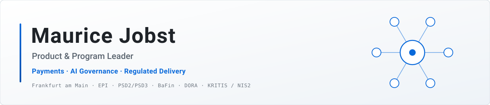
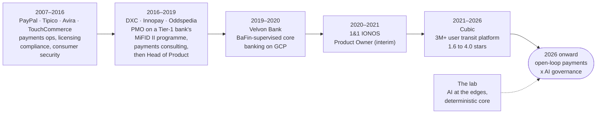

<p align="center">
  <picture>
    <source media="(prefers-color-scheme: dark)" srcset="assets/header-dark.svg">
    <source media="(prefers-color-scheme: light)" srcset="assets/header-light.svg">
    
  </picture>
</p>

<p align="center">
  <a href="https://www.linkedin.com/in/mauricejobst/"></a>
  <a href="mailto:maurice.jobst@gmail.com"></a>
  <a href="https://maurice-jobst.github.io/"></a>
</p>

<p align="center">
  <b>I build payment products for public transport, and I keep AI on a short leash 💳🤖</b><br>
  📍 Frankfurt am Main · Rhein-Main · Germany-wide hybrid · 🗣️ German and English, both at native level<br>
  💬 Employed, and open to Principal-level mandates in payments leadership and AI governance, employed or freelance
</p>

---

15+ years in payments, fintech, cybersecurity and public-sector mobility, and payments runs through all of it: PayPal in Dublin, gaming-payments compliance, multi-gateway platforms, core banking under BaFin, and today open-loop transit payments, which I own end to end.

One rule runs through how I work: **AI at the edges, deterministic core.** AI drafts and sorts; a named human signs off. I practise it every day in a small lab at home 🧪, and I'm working toward **Principal-level mandates** where payments and AI governance meet regulated delivery.

## 💼 Now

**Senior Product Manager, Cubic Transportation Systems** (2026–present, at Cubic since 2021)
Umo Pass, open-loop payments owned end to end for the US, Canada and Oceania, from EMV acceptance at the validator to the account-based back office, working remotely into a California product team. Umo is not in EMEA yet: I own the compliance groundwork for its first European bids, where EU digital identity at the gate (eligibility, boarding, payment) meets account-based ticketing and European payment sovereignty (EPI). Authored the product organization's AI usage standard, in use today.

📄 **[Open-loop payments case study →](case-studies/open-loop-payments-end-to-end.md)**

## 📈 Track record



### 🚆 Cubic Transportation Systems · Senior Technical Project Manager (2021–2026)

I took a **3M+ user** public-transit platform from **1.6 to 4.0 app-store stars** and carried it through Germany's politically charged *Deutschland-Ticket* national rollout with zero downtime. The client renewed **€2M+ a year** after I held the program to a sustained SLA regime.

I led **20+ people across vendors and partner organizations** through that delivery governance, holding no disciplinary line over any of them. Cubic chartered me in the 2024 objectives to help establish **Hamburg as its EMEA Technology Competence Center**. It runs today.

📄 **[Delivery-governance case study →](case-studies/deutschland-ticket-turnaround.md)**

### 🏦 Velvon Bank · Product Manager (2019–2020)

I turned KWG requirements into deterministic engineering specifications for audit-ready core banking on GCP, under BaFin scrutiny, for a German banking-license acquisition. The parent stopped the German launch in early 2020, before the bank opened.

📄 **[Payments case study: turning a banking act into engineering specifications →](case-studies/banking-act-to-specifications.md)**

<details>
<summary><b>📚 Earlier roles (2007–2021) and credentials</b></summary>

<br>

| Where | What |
|---|---|
| **1&1 IONOS** (2020–2021) | Product Owner (interim) |
| **Oddspedia** (2018–2019) | Head of Product Management. Owned the whole product function, 7–10 across product, design and engineering, reporting to C-level |
| **Innopay** (2017) | Management Consultant. Payments and open-banking strategy consulting for German banks in the PSD2 run-up |
| **DXC Technology** (2016–2017) | PMO on a Tier-1 bank's MiFID II programme |
| **TouchCommerce** (2014–2016) | Customer Success Manager, enterprise DACH accounts, a two-person German office serving Vodafone, Sky and Sunrise |
| **Avira** (2012–2013) | Consumer-security delivery |
| **Tipico** (2010–2012) | Payment and licensing compliance |
| **PayPal, Dublin** (2007–2010) | Payments operations |

🎓 PSPO II · PSM I · Executive MBA program, Postgraduate Certificate (Dublin Business School)
📚 Part-time lecturer in e-commerce and online payments, Dublin Business School (2009–2011, alongside the MBA)

</details>

## 🗣️ What colleagues say

> "His thinking was holistic — not just as a project manager, but as a true project strategist."
>
> **Marco Omilipo**, Senior Bid Manager, Cubic Transportation Systems

> "He doesn't just manage projects — he enables people to do their best work."
>
> **Ivan Demin**, Lead Java Fullstack Developer

> "He was Head of Product Management at the time, and I reported directly to him. One of his best qualities is how easily he can motivate a team to give 101%."
>
> **Jonko Bukovski**, Head of Product Design, Oddspedia

Quoted verbatim from LinkedIn recommendations, trimmed for length. The full set is on **[the site](https://maurice-jobst.github.io/#voices)**.

## 🤝 How I lead

Twice, under opposite conditions. At Oddspedia I held the line: the company's whole product function, seven to ten people across product, design and engineering, reporting to the C-level, and the hiring and the letting go were mine. At Cubic I held none, and 20+ people across vendors and partner organizations worked to a governance model I designed, because it was the fairest route to getting their own urgency heard.

I would rather have the second kind. The programs worth running now cross boundaries the org chart does not reach, and inside those I want people who chose to be there.

## 🧪 The lab

I run my household's infrastructure estate the way a regulated hub-and-spoke organization should run: one reconcile shape, doctrine that lives once, AI under symmetric human and machine review, and drift as the primary enemy. The scale is a household. A cooperative banking group or a KRITIS operator has the same problem shape, so I practice the model here before I argue for it in a boardroom.

📄 **[Case study: running an infrastructure estate like a regulated hub-and-spoke organization →](case-studies/hub-and-spoke-estate.md)**

Before the estate, the same doctrine ran two projects, both archived and private now: **ai-workbench**, a file-first system for running PM work with an AI agent, and **BEMBEL**, a free iPhone city app for Frankfurt / Rhein-Main whose code AI agents wrote under human review of every pull request.

## 🧭 Where this is going

Regulators already ask companies to prove they run the way their own policies say. Put AI in the delivery path and that gets harder. You need decisions you can trace, a deterministic core where results must be reproducible, and drift alerts that fire without anyone pressing a button.

Article 14 of the EU AI Act asks for human oversight that works: people with the authority and the information to override a system. Nothing I run today falls under it 🙂 I apply the standard anyway, and ISO/IEC 42001 is where an auditor would test it. That's the work I want to do next.

## 🎯 Domain focus

| | |
|---|---|
| 💳 **Payments** | EPI / Wero · open-loop EMV · Instant Payments · PSD2 / PSD3 / PSR · Verification of Payee · digital euro · account-centric transit |
| 🤖 **AI Governance** | EU AI Act, Article 14 human oversight · ISO/IEC 42001 · auditable decision paths |
| 🛡️ **Resilience & Regulation** | DORA · MaRisk / BAIT · BaFin · KWG · MiFID II · KRITIS / NIS2 |
| ☁️ **Regulated Cloud** | GCP under supervision · GitOps · Infrastructure-as-Code |
| 🧭 **Leadership** | Whole product function, 7–10 reporting to C-level · 20+ across vendors and partner organizations · €5M+ B2G program · distressed-program turnaround |

**Delivered under:** KWG and BaFin supervision, a Tier-1 bank's MiFID II programme (PMO), gaming-license and payment compliance, PSD2 and public-sector procurement.
**Advisory and bid work, not yet delivery:** DORA, KRITIS / NIS2, Instant Payments Regulation, Verification of Payee, digital euro, EU AI Act and ISO/IEC 42001, for transit authorities in Germany, the UK and Ireland, Cubic internally, and bids in three further markets.

<details>
<summary><b>🤖 At a glance (machine-readable)</b></summary>

<br>

The same facts as the prose above, in a form that parsers can read. A validator in this repository checks that the two stay in agreement.

```yaml
name: Maurice Jobst
location: Frankfurt am Main, Germany (Rhein-Main)
mobility: Rhein-Main on site; hybrid or remote Germany-wide
languages: [German (native), English (native/bilingual)]
current_role: Senior Product Manager, Cubic Transportation Systems (2026–present; at Cubic since 2021)
experience_years: 15+
open_to: "Employed. Open to Principal-level product and leadership mandates, employed or
          freelance: Head of Product, Head of Payments, practice build-out"
career: [PayPal 2007–2010, Tipico 2010–2012, Avira 2012–2013, TouchCommerce (later Nuance) 2014–2016,
         DXC Technology 2016–2017, Innopay 2017, Oddspedia (Head of Product) 2018–2019,
         Velvon Bank 2019–2020, 1&1 IONOS 2020–2021, Cubic Transportation Systems 2021–present]
domains: [payments, open-loop payments (EMV), instant payments,
          payment sovereignty (EPI/Wero), digital euro,
          product management, program management, AI governance,
          regulated-industry delivery, public-sector mobility, core banking]
regulatory_context_delivered: [BaFin, KWG, MiFID II (PMO), PSD2, gaming-license compliance,
                               public-sector procurement]
regulatory_context_advisory: [DORA, EU AI Act (Art. 14 human oversight),
                     ISO/IEC 42001, PSD3/PSR, Verification of Payee,
                     Instant Payments Regulation, EPI, KRITIS, NIS2]
leadership:
  direct_reports: "Head of Product Management, Oddspedia 2018–2019: owned the company's
                   entire product function, 7–10 across product, design/data and
                   engineering, reporting to C-level, including hiring and exits."
  matrix: "Led 20+ people across vendors and partner organizations through the
           Deutschland-Ticket delivery governance, with no disciplinary line."
  portfolio: "Led delivery of a €5M+ B2G digital-mobility program end to end."
  org_building: "Cubic chartered me in the 2024 objectives to help establish Hamburg as
                 its EMEA Technology Competence Center; it operates today."
highlights:
  - "3M+ user public-transit platform turned around from 1.6 to 4.0 app-store stars
     through the Deutschland-Ticket national rollout, zero downtime"
  - "€2M+ in annual client renewals secured through sustained SLA compliance"
  - "Audit-ready core banking on GCP under BaFin scrutiny for a banking-license acquisition;
     the parent stopped the launch in early 2020 before the bank opened"
  - "Chartered to help establish Hamburg as Cubic's EMEA Technology Competence Center (2024)"
  - "Authored the product organization's AI usage standard, in use today"
credentials: [PSPO II, PSM I,
              "Executive MBA program, Postgraduate Certificate (Dublin Business School)",
              "Part-time lecturer in e-commerce and online payments, Dublin Business School (2009–2011)"]
past_work:
  - "ai-workbench (archived, private): file-first PM system built to run with an AI agent"
  - "bembel-data (archived, private): datasets for Frankfurt designed for community contribution,
     with entries and ratings as pull requests and review rules enforced by CI"
  - "BEMBEL (archived, private): iPhone city app for Frankfurt/Rhein-Main, written by AI agents
     under human review"
building_toward: Principal-level product and leadership mandates. Payments leadership
                 and AI governance in regulated-industry delivery. Frankfurt / Rhein-Main.
contact: {linkedin: "https://www.linkedin.com/in/mauricejobst/", email: "maurice.jobst@gmail.com",
          site: "https://maurice-jobst.github.io/"}
```

</details>

## 📬 Reach me

Start the conversation on **[LinkedIn](https://www.linkedin.com/in/mauricejobst/)**, or write to **[maurice.jobst@gmail.com](mailto:maurice.jobst@gmail.com)**. The long version, including a printable CV, lives at **[maurice-jobst.github.io](https://maurice-jobst.github.io/)**.
